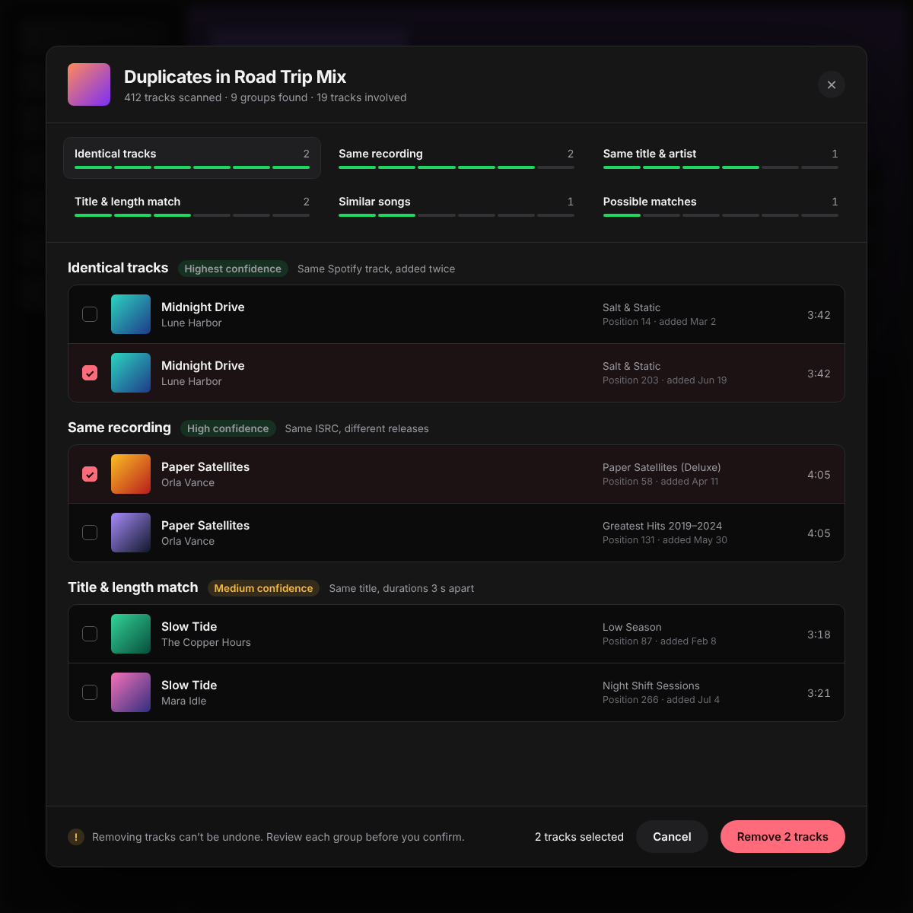

# Playlist Duplicate Finder

Find duplicate tracks in any playlist, grouped by confidence level, then review and remove exactly the ones you choose.



## Features

- **Context Menu Integration**: works from the playlist context menu (sidebar and playlist pages)
- **6 Confidence Levels**: every duplicate candidate is filed in exactly one level, from certain to speculative
- **Level Rail with Confidence Gauges**: a 6-segment gauge per level shows how reliable its matches are — only levels that actually found something are listed
- **Click-anywhere Selection**: click anywhere on a track row to select it; no pixel hunting on tiny checkboxes
- **Select All / Deselect All per Level**: one click checks every group of the level you are reviewing — always excepting one entry per group, so a song never disappears entirely
- **Editable-permission Aware**: full review on any playlist; if it is read-only a banner explains exactly why (you are neither the owner nor a collaborator)
- **Occurrence-accurate Removal**: repeated tracks are removed by their playlist position id, not just by URI
- **Batch Progress + Partial Failure Recovery**: removal reports progress and lets failed batches be retried
- **Review-first UX**: nothing is preselected, nothing is removed without an explicit confirmation

## Duplicate levels

| Level | Meaning |
|-------|---------|
| Identical Tracks | the same Spotify entry added to the playlist several times |
| Same Recording | different Spotify entries sharing an ISRC (identical audio, different release) |
| Same Title & Artist | same title plus at least one shared artist |
| Title & Length Match | same title, durations within 5 seconds |
| Similar Songs | similar titles and similar durations — may include remixes and covers |
| Possible Matches | low-confidence title similarity only — review very carefully |

## Usage

1. Right-click a playlist in the sidebar (or in a playlist list) and choose "Find Duplicates"
2. Wait for the scan to finish (the window also fetches ISRC data for the "Same Recording" level)
3. Browse the levels in the rail — each shows its name, group count and a confidence gauge
4. Select tracks by clicking anywhere on their rows, or hit "Select all" to check every duplicate of the level at once — one entry per group is always left out (the earliest one, which stays in the playlist)
5. Click "Remove N tracks", confirm, done — failed removals stay selectable to retry

Note: removal is permanent. Everything is scanned read-only first; nothing is deleted without your explicit confirmation.

## Requirements

- Spicetify CLI installed

## Installation

Copy the extension into your Spicetify extensions folder:

```bash
# Windows
copy dist\playlistDuplicateFinder.mjs %APPDATA%\spicetify\Extensions\

# macOS / Linux
cp dist/playlistDuplicateFinder.mjs ~/.config/spicetify/Extensions/
```

Then enable:

```bash
spicetify config extensions playlistDuplicateFinder.mjs
spicetify apply
```

## Contributing

Found a bug or want to contribute? Here's how you can help:

- **Issues**: [Open an issue](https://github.com/JimMarley420/spicetify-extension/issues/new/choose)
- **Pull Requests**: [Create a PR](https://github.com/JimMarley420/spicetify-extension/compare)
- **Discussion**: [Start a discussion](https://github.com/JimMarley420/spicetify-extension/discussions)

## License

Copyright (c) 2026 JimMarley420

All rights reserved. This extension is provided for personal use only.

**You are NOT allowed to:**
- Republish or redistribute this extension on Spicetify Marketplace
- Claim authorship of the original work
- Fork and redistribute (modifications for personal use are allowed)
